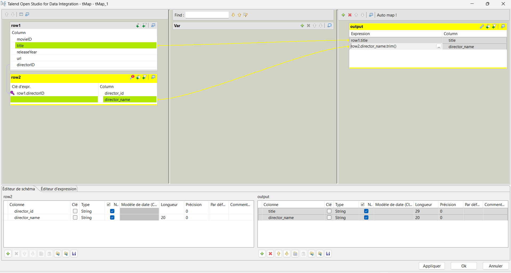
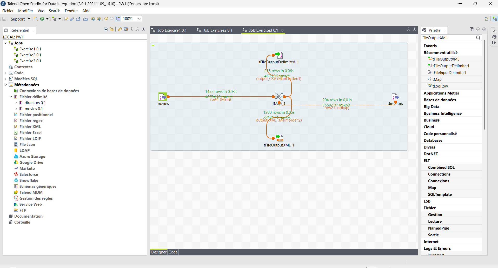

# Lab 5 – Data Integration with Talend Open Studio

**Course:** Introduction to Business Intelligence – Chapter 4 *From ETL to OLAP: Building Reliable Data Warehouses*
**Author:** Dorline TIAKO OKASSIE – ING4 Data & Artificial Intelligence, Group 01 – ECE Paris
**Tool:** Talend Open Studio for Data Integration 8.0.1

## Objectives

| Exercise | ETL step | Goal |
|---|---|---|
| Exercise 1 | **Extract** | Read `movies.csv` and display the data in the Run console |
| Exercise 2 | **Transform** | Join movies with directors (tMap, Inner Join) and keep only valid movies |
| Exercise 3 | **Load** | Write valid movies to a CSV file and rejected movies to an XML file |

## Input data

| File | Format | Content |
|---|---|---|
| `data/input/movies.csv` | `;` separator, header, UNIX line endings | 1,455 movies (movieID, title, releaseYear, url, directorID) |
| `data/input/Directors.txt` | `,` separator, no header, WINDOWS line endings | 204 directors (director_id, director_name) |

## Jobs

```
Exercise 1   movies (tFileInputDelimited) ──Main──▶ tLogRow

Exercise 2   movies    ──Main────▶ ┐
                                   ├─ tMap (Inner Join on directorID = director_id) ──output──▶ tLogRow
             directors ──Lookup──▶ ┘

Exercise 3   movies    ──Main────▶ ┐          ┌─ output_CSV (reject = false) ─▶ tFileOutputDelimited → valid_movies.csv
                                   ├─ tMap ───┤
             directors ──Lookup──▶ ┘          └─ output_XML (reject = true)  ─▶ tFileOutputXML       → invalid_movies.xml
```

Key tMap settings:
- Join key: `row1.directorID = row2.director_id` (both typed **String**)
- Join Model: **Inner Join**
- `output_CSV`: `row1.title`, `row2.director_name.trim()` – *Catch lookup inner join reject = false*
- `output_XML`: `row1.title` – *Catch lookup inner join reject = true*

## Results

| Flow | Rows |
|---|---|
| Movies read | 1,455 |
| Directors read | 204 |
| Valid movies → `data/output/valid_movies.csv` | **255** |
| Rejected movies → `data/output/invalid_movies.xml` | **1,200** |

Consistency check: 255 + 1,200 = 1,455. Every movie ends up in exactly one output file.

## Data quality issues observed (Chapter 4)

| Problem | Observation | Treatment |
|---|---|---|
| Missing data | 1,200 movies with an empty directorID | Rejected by the Inner Join, kept in the XML file |
| Noisy data | Extra spaces/tabs around director names | `.trim()` in the tMap |
| Duplicated data | Repeated titles; Barbet Schroeder listed twice | Identified |
| Encoding | Accents already lost in the sources (`Cuar�n`, `C?r?monie`) | Must be fixed at the source |
| Format conflicts | `;` vs `,`, header vs no header, UNIX vs WINDOWS | Two separate metadata definitions |

## Repository content

```
Lab5_Data_Integration_Talend/
├── README.md
├── data/
│   ├── input/        movies.csv, Directors.txt
│   └── output/       valid_movies.csv, invalid_movies.xml
├── docs/
│   ├── Lab5_Subject.docx                               lab instructions
│   ├── Lab5_Data_Integration_TIAKO_OKASSIE_Dorline     lab report (docx + pdf)
│   └── Fiche_Revision_Ch4_Lab5                         revision sheet in French (docx + pdf)
└── screenshots/      16 screenshots of the Talend jobs and executions
```

## Screenshots

| Exercise 2 – tMap | Exercise 3 – Result |
|---|---|
|  |  |
